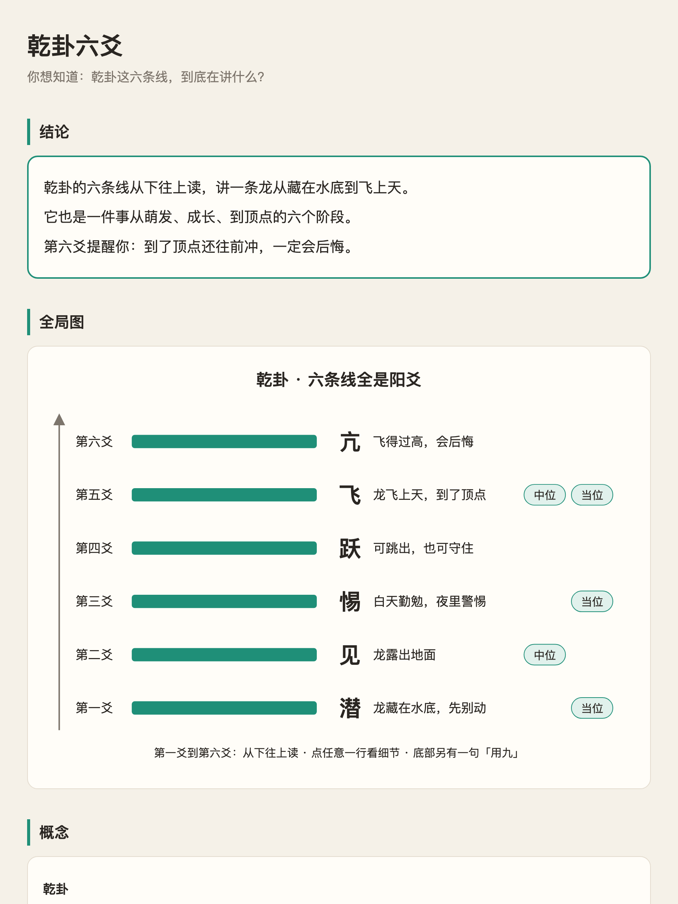

# 看懂（kandong）

AI 的回答越写越长，每个字都认识，连起来看不懂。**看懂**是一个 Agent Skill：把一大段长回答变成一页 HTML，先看全局，再点开细节。



## 它做什么

同一份内容分三层处理：

1. **文字层**：按一套中文写作规则改写，消除歧义（一个东西只叫一个名字、一句一事、不丢条件和数字）。
2. **结构层**：拆成「结论 / 待定 / 概念 / 关系 / 细节」五格，做成一页离线 HTML：结论在第一屏，一张全局图，细节默认收起，原文放最底下。需要你拍板的事做成按钮，点完「复制回复」粘回对话就行。
3. **讲解层**（可选）：把骨架写成讲解视频的分镜稿，交给你手上的视频工具渲染。

页面存在临时文件夹。你说「存进知识库」，它才另外写一篇 Markdown 笔记（Obsidian、Notion 都能用）。

## 安装

Claude Code：

```bash
git clone https://github.com/jeszhou/kandong-skill ~/.claude/skills/kandong
```

Codex：

```bash
git clone https://github.com/jeszhou/kandong-skill ~/.codex/skills/kandong
```

只依赖 `python3`（标准库），不用装别的。

## 怎么用

| 你说 | 它做 |
|---|---|
| 「看不懂」「太长了」「出 HTML」 | 把上一条回答（或你给的文字、文件）做成看懂页面 |
| 「存进知识库」 | 把页面和一篇笔记存进你的知识库文件夹 |
| 「做成视频」 | 写一份讲解视频分镜稿 |

**注意**：AI 自己写了一段很长的回答（超过约 800 字，或有 3 个以上你可能不熟的概念）时，它也会主动出一页。不想要的话，删掉 `SKILL.md` 开头 `description` 里「你刚写完一段很长的回答……」那一句。

第一次存知识库时，它会问你文件夹在哪，记在 `~/.config/kandong/config.json`：

```json
{ "kb_dir": "/path/to/你的知识库/看懂" }
```

## 文件

```
SKILL.md                      给 AI 看的步骤
references/中文写作规则.md     文字层的改写规则
references/笔记格式.md         知识库笔记模板
references/讲解视频分镜.md     讲解层的分镜稿格式
assets/page-template.html     页面结构模板（样式每次按内容现做）
scripts/check_page.py         页面自检：区块齐全、占位字已替换、结论 ≤3 句
examples/乾卦六爻/             样例：原文 → 页面 → 笔记
```

## 致谢

中文写作规则改编自 [danyuchn/asd-ste100-skill](https://github.com/danyuchn/asd-ste100-skill)（MIT），它把航空维修手册用的简化技术英语（ASD-STE100）做成了 skill。

## 许可

MIT · 一页枝鸥
